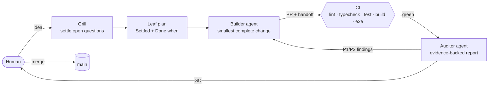

# Template project

[](https://github.com/Schwibl/template-project/actions/workflows/ci.yml)

A starter for **AI-first development**: AI agents do most of the planning, building and reviewing, and a human makes the decisions. It is a TypeScript app with strict checks, tests and CI, plus the agent setup that makes the agents predictable.

## How the workflow runs



1. **Plan before code.** A fuzzy request is _grilled_ (the agent asks short rounds of questions, each with a recommended answer) and turned into a _leaf plan_: locked decisions plus numbered steps with "Done when". See [`.prompts/base/how_to_cook.md`](.prompts/base/how_to_cook.md).
2. **Builder builds one leaf** on a branch, following the [Ponytail](https://github.com/DietrichGebert/ponytail) rules: the smallest change that fully solves the problem. It opens a PR with a [handoff](agents/handoff.md) checklist.
3. **CI gates the PR**: lint, typecheck, unit tests, build, then Playwright e2e on desktop and mobile.
4. **Auditor reviews before merge**: it re-runs the checks, walks the checklist, and grades findings P1–P3 with evidence. See [`agents/auditor.md`](agents/auditor.md).
5. **Human merges.** Hard-to-reverse choices are recorded as [ADRs](docs/adr/).

## What's inside

| Path                       | Purpose                                                             |
| -------------------------- | ------------------------------------------------------------------- |
| `AGENTS.md`                | Thin router every agent loads: triggers, repo facts, Ponytail rules |
| `.prompts/base/`           | How to plan (cook), git and document                                |
| `agents/`                  | Builder and auditor role prompts, handoff format                    |
| `skills/`                  | Reusable agent skills: `grill`, `handoff`, `audit`                  |
| `docs/adr/`                | Decision record template and examples                               |
| `docs/agents/`             | Local ticket tracker and triage labels                              |
| `src/`, `e2e/`             | Minimal Vite + TypeScript app, Vitest and Playwright samples        |
| `.github/workflows/ci.yml` | PR check                                                            |

## Quick start

```bash
npm ci
cp .env.example .env
npm run dev          # http://localhost:5173
npm run lint && npm run typecheck && npm test && npm run build
npx playwright install chromium && npm run e2e
```

Set `E2E_BASE_URL` to run the e2e specs against a deployed preview instead of a local build.

## Using it

Click **Use this template**, rename the package, replace `src/` with your app, and keep the agent files. Trim `AGENTS.md` triggers to what your project actually has.

## Credits

Ponytail rules in `AGENTS.md` are from [DietrichGebert/ponytail](https://github.com/DietrichGebert/ponytail) (MIT). See [`THIRD_PARTY_NOTICES.md`](THIRD_PARTY_NOTICES.md).

## License

[MIT](LICENSE)
